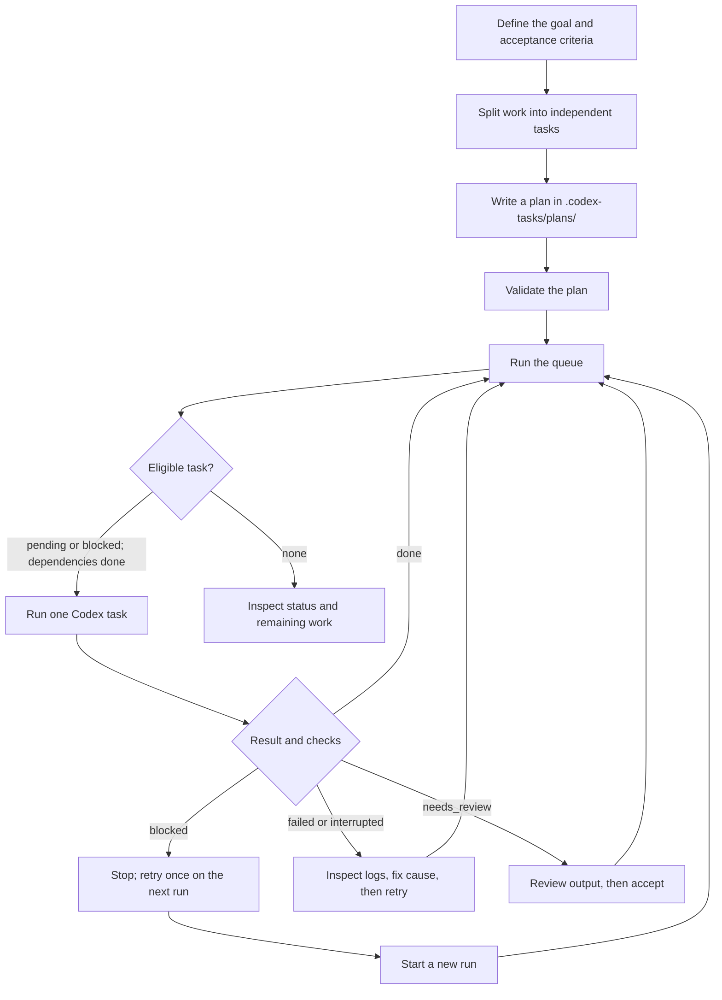
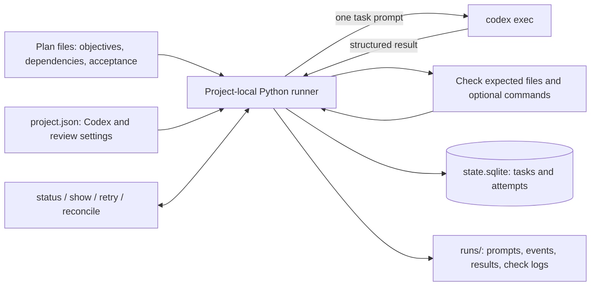

# Codex Task Runner

[简体中文 README](README.zh-CN.md)

Codex Task Runner turns a larger goal into a queue of small, independently executable tasks. A project-local Python script reads JSON or YAML plans, runs one task at a time through Codex CLI, records progress, and resumes work across invocations. Copy the tool and its planning skill into a project; no local API or service is required.

## Quick start

You need Python 3.10+ and an installed, authenticated Codex CLI. JSON plans use only the Python standard library. YAML plans additionally require `PyYAML`.

From this repository, install the portable kit into an existing project:

```bash
python3 scripts/copy_to_project.py /path/to/project
```

You can also copy `kit/.codex-tasks/` and `kit/.agents/` directly to the target project's root. The installer does not overwrite existing files with different content or replace an existing project configuration. In the target project, create a plan in `.codex-tasks/plans/`, then run:

```bash
python3 .codex-tasks/run.py validate
python3 .codex-tasks/run.py status
python3 .codex-tasks/run.py run --max-tasks 2
python3 .codex-tasks/run.py status
```

The project skill at `.agents/skills/codex-task-planner/SKILL.md` can help Codex break down a goal; invoke `$codex-task-planner` or write a plan yourself. Example development and non-development plans are in `.codex-tasks/examples/`. Copy and adapt an example into `plans/` before running it. For a project without Git, set `skip_git_repo_check` to `true` in `.codex-tasks/project.json`.

## Workflow



Each `run` invocation executes eligible tasks serially. A previously `blocked` task has priority over independent `pending` tasks and is attempted once in the new invocation. If it is still blocked, the runner stops again. `failed` and `interrupted` tasks require an explicit `retry`; a task requiring human review needs `accept`. Editing a completed task marks that task and completed dependents as `changed`; pending dependents wait for their dependencies. Use `reconcile` when you intend to rerun the changed task and its dependents.

`run` stays in the foreground by default and streams Codex progress, command output, and check output to the terminal. Use `--foreground` to select this explicitly, or `--background` to return to the shell while a detached runner continues. The background command prints its PID and log path; follow that log with `tail -f PATH` and query task state with `status`. Press Ctrl-C to interrupt a foreground task. Only one runner can work in a project at a time.

## How it works



Plans are definitions, not a progress ledger. The runner selects tasks whose dependencies are complete, asks Codex to work in the target project, checks its structured completion result, verifies listed artifacts and optional check commands, then saves the attempt and status locally in SQLite. SQLite is part of Python and needs no database server. Run logs stay in `.codex-tasks/runs/`; both logs and the state database are ignored by Git. `status --json` exposes progress to other scripts.

`acceptance` tells Codex and reviewers what success means; it is not automatically proven by the runner. Use `artifacts` and `checks` for outcomes that can be verified mechanically. The runner does not automatically commit, push, deploy, or write to external services.

## Plan format

A plan is one `.json`, `.yaml`, or `.yml` file in `.codex-tasks/plans/`. This minimal JSON plan works without extra Python packages:

```json
{
  "version": 1,
  "plan": {"id": "onboarding", "title": "Write onboarding documentation"},
  "tasks": [
    {
      "id": "draft",
      "title": "Draft the guide",
      "objective": "Create docs/onboarding.md for new contributors",
      "acceptance": ["The guide explains setup and the first validation command"],
      "artifacts": ["docs/onboarding.md"]
    },
    {
      "id": "review",
      "title": "Review the guide",
      "objective": "Verify the guide against the project and correct inaccuracies",
      "depends_on": ["draft"],
      "acceptance": ["Commands and paths match the current project"],
      "artifacts": ["docs/onboarding.md"]
    }
  ]
}
```

Task keys have the form `plan-id/task-id`. A task may also list existing project-relative `context` files and `checks`, such as `{"argv": ["python3", "-m", "unittest", "discover", "-s", "tests"]}`. Dependencies refer to task IDs in the same plan. See the [integration and task standard](docs/项目集成流程与任务标准.md) for the full workflow and field rules.

## Useful commands

Run these from the target project's root:

| Command | Purpose |
| --- | --- |
| `python3 .codex-tasks/run.py validate` | Validate configuration, plans, paths, and dependencies. |
| `python3 .codex-tasks/run.py status --json` | Query task status in a machine-readable form. |
| `python3 .codex-tasks/run.py run` | Run in the foreground with live output until no task is runnable or one needs attention. |
| `python3 .codex-tasks/run.py run --foreground` | Explicitly select foreground execution. |
| `python3 .codex-tasks/run.py run --background` | Run detached; print PID and `.codex-tasks/background/*.log` path. |
| `python3 .codex-tasks/run.py run --max-tasks 2` | Run at most two tasks in this invocation. |
| `python3 .codex-tasks/run.py run --task onboarding/draft` | Run one eligible task. |
| `python3 .codex-tasks/run.py show onboarding/draft` | Show status, attempts, and log locations. |
| `python3 .codex-tasks/run.py retry onboarding/draft` | Reset a failed or interrupted task for another run. |
| `python3 .codex-tasks/run.py accept onboarding/draft` | Accept a task waiting for human review. |
| `python3 .codex-tasks/run.py reconcile onboarding/draft` | Reset a changed task and downstream tasks. |

## Repository development

The maintained implementation is in `src/codex_task/`. Run `python3 scripts/build_kit.py` after changing it to refresh the copyable `kit/`. To run the repository tests, install the optional development package and then use:

```bash
python3 -m pip install -e .
python3 -m unittest discover -s tests -v
```

The Python package entry point remains available for development. Copying the kit is the recommended integration path for other projects.
