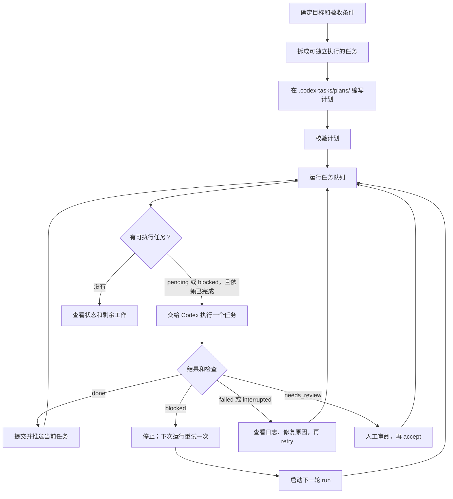
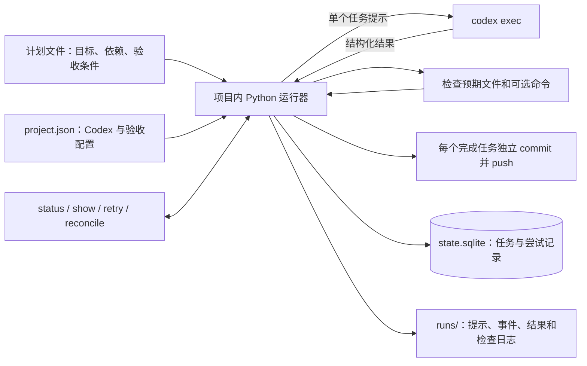

# Codex 任务运行器

[English README](README.md)

Codex 任务运行器把较大的目标拆成可以独立执行的小任务。项目内的 Python 脚本读取 JSON 或 YAML 计划，逐个调用 Codex CLI，记录进度，并在下次启动时继续执行。只需把工具和规划 skill 复制到目标项目；不需要本地 API 或服务。

## 快速开始

需要 Python 3.10+，以及已安装、已登录的 Codex CLI。JSON 计划只依赖 Python 标准库；YAML 计划还需要 `PyYAML`。

在本仓库运行安装脚本，将可复制工具包放进已有项目：

```bash
python3 scripts/copy_to_project.py /path/to/project
```

也可以直接把 `kit/.codex-tasks/` 和 `kit/.agents/` 复制到目标项目根目录。安装脚本不会覆盖内容不同的现有文件，也不会替换已有项目配置。在目标项目的 `.codex-tasks/plans/` 中编写计划，然后运行：

```bash
python3 .codex-tasks/run.py validate
python3 .codex-tasks/run.py status
python3 .codex-tasks/run.py run --max-tasks 2
python3 .codex-tasks/run.py status
```

项目级 skill 位于 `.agents/skills/codex-task-planner/SKILL.md`。可以调用 `$codex-task-planner` 让 Codex 拆解目标，也可以自己编写计划。`.codex-tasks/examples/` 提供开发和非开发任务示例；执行前先复制并改写到 `plans/`。非 Git 项目需在 `.codex-tasks/project.json` 中设置 `skip_git_repo_check: true`、`auto_commit: false` 和 `auto_push: false`。

## 工作流程



每次 `run` 都串行执行可运行的任务。上次处于 `blocked` 的任务优先于独立的 `pending` 任务，并在新一轮运行中尝试一次；若仍阻塞，就再次停止。`failed` 和 `interrupted` 需要显式执行 `retry`；等待人工验收的任务需要 `accept`。修改已完成任务的定义后，该任务和已完成的下游任务会进入 `changed`，尚未执行的下游任务继续等待依赖；确认要重跑时执行 `reconcile`。

`run` 默认留在前台，实时显示 Codex 进度、命令输出和检查输出。也可显式指定 `--foreground`；使用 `--background` 才会脱离终端继续运行。后台命令会打印进程 PID 和日志路径，可用 `tail -f 日志路径` 持续查看，并用 `status` 查询任务状态。前台按 Ctrl-C 可中断当前任务。同一项目同一时间只能运行一个任务执行器。

`run` 现在默认给每个子 `codex exec` 传入 `--dangerously-bypass-approvals-and-sandbox`，子任务不再请求 Codex 审批，也不受 Codex 自身沙箱限制。`--dangerous` 可显式指定这个默认模式；需要使用 `.codex-tasks/project.json` 或 `project.yaml` 配置的沙箱时，改用 `run --sandboxed`，并可与 `--background` 组合。默认模式让子 Codex 完全访问本机，因此只适合可信项目和运行环境。它不能解除启动脚本的上层 Codex 会话或外部沙箱限制；若上层有限制，应从自己的系统终端启动脚本。

## 工作原理



计划文件只定义任务，不保存执行状态。运行器选择依赖已完成的任务，让 Codex 在目标项目中工作，读取结构化完成结果，验证预期产物和可选检查命令，再把尝试记录和状态写入本地 SQLite。SQLite 随 Python 提供，无需数据库服务。每次尝试在 `.codex-tasks/runs/` 下有独立目录，保存提示词、调用参数和权限模式（`invocation.json`）、原始 Codex 事件（`events.jsonl`）、错误输出、结构化结果、检查输出和 Git 收尾结果（`git.log`）。运行器自身异常还会保存 `runner-error.log` 堆栈。`show 计划ID/任务ID` 列出所有历史尝试目录及文件；后台运行另在 `.codex-tasks/background/` 保存终端进度日志。日志和状态数据库均被 Git 忽略。其他脚本可以读取 `status --json` 的结果。

`acceptance` 告诉 Codex 和审阅者什么算完成；运行器不会自动证明这些文字条件。能机械验证的结果应写入 `artifacts` 和 `checks`。任务通过后，运行器默认为每个任务创建一个 Git commit 并立即 push。启动时要求工作区干净，避免把已有人工修改混进任务提交。可在 `project.json` 或 `project.yaml` 中配置 `auto_commit`、`auto_push`、`git_remote`、`git_branch` 和 `commit_prefix`；非 Git 项目需同时关闭两个自动选项。部署和其他外部写入仍不由运行器处理。

主要项目配置如下：

| 配置 | 默认值 | 含义 |
| --- | --- | --- |
| `auto_commit` | `true` | 每个完成任务创建一个独立提交。 |
| `auto_push` | `true` | 每次提交后立即推送；必须同时启用 `auto_commit`。 |
| `git_remote` | `origin` | 自动推送使用的远程仓库。 |
| `git_branch` | `null` | 推送到当前分支；设置分支名可覆盖。 |
| `commit_prefix` | `task` | 自动生成提交标题的前缀。 |
| `sandbox` | `workspace-write` | 仅在使用 `run --sandboxed` 时生效。 |

## 计划格式

一个计划是 `.codex-tasks/plans/` 下的一个 `.json`、`.yaml` 或 `.yml` 文件。下面的最小 JSON 示例不需要额外 Python 包：

```json
{
  "version": 1,
  "plan": {"id": "onboarding", "title": "编写入门文档"},
  "tasks": [
    {
      "id": "draft",
      "title": "编写初稿",
      "objective": "为新贡献者创建 docs/onboarding.md",
      "acceptance": ["文档说明环境配置和第一条验证命令"],
      "artifacts": ["docs/onboarding.md"]
    },
    {
      "id": "review",
      "title": "核对文档",
      "objective": "对照当前项目核对文档并修正错误",
      "depends_on": ["draft"],
      "acceptance": ["命令和路径与当前项目一致"],
      "artifacts": ["docs/onboarding.md"]
    }
  ]
}
```

任务键的格式为 `计划ID/任务ID`。任务还可以列出已存在的项目相对路径 `context` 和检查命令 `checks`，例如 `{"argv": ["python3", "-m", "unittest", "discover", "-s", "tests"]}`。依赖只能引用同一计划内的任务 ID。完整流程和字段约定见[项目集成流程与任务标准](docs/项目集成流程与任务标准.md)。

## 常用命令

在目标项目根目录运行：

| 命令 | 用途 |
| --- | --- |
| `python3 .codex-tasks/run.py validate` | 校验配置、计划、路径和依赖。 |
| `python3 .codex-tasks/run.py status --json` | 以 JSON 查询任务进度。 |
| `python3 .codex-tasks/run.py run` | 默认前台实时输出，执行到没有可运行任务或遇到需要处理的任务。 |
| `python3 .codex-tasks/run.py run --foreground` | 显式选择前台运行。 |
| `python3 .codex-tasks/run.py run --background` | 后台无人值守运行，打印 PID 和 `.codex-tasks/background/*.log` 路径。 |
| `python3 .codex-tasks/run.py run --sandboxed` | 改用项目配置的 Codex 沙箱。 |
| `python3 .codex-tasks/run.py run --max-tasks 2` | 本轮最多执行两个任务。 |
| `python3 .codex-tasks/run.py run --task onboarding/draft` | 只执行一个符合条件的任务。 |
| `python3 .codex-tasks/run.py show onboarding/draft` | 查看状态、尝试记录和日志位置。 |
| `python3 .codex-tasks/run.py retry onboarding/draft` | 将失败或中断的任务重置为待运行。 |
| `python3 .codex-tasks/run.py accept onboarding/draft` | 验收等待人工审阅的任务。 |
| `python3 .codex-tasks/run.py reconcile onboarding/draft` | 重置已变更任务及其下游任务。 |

## 本仓库开发

维护中的源码位于 `src/codex_task/`。修改后运行 `python3 scripts/build_kit.py` 同步可复制的 `kit/`。安装可选的开发包后运行测试：

```bash
python3 -m pip install -e .
python3 -m unittest discover -s tests -v
```

Python 包入口仍可用于本仓库开发；集成到其他项目时推荐复制工具包。
